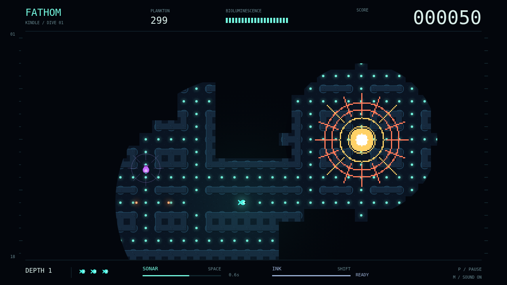

# Fathom

Your light is a lifeline. And a lure. Slip into a flooded maze as a tiny glowing forager, grazing points of plankton in water too dark to trust. Every mouthful makes your light swell, opening a wider window onto the deep—and making you easier to find.

The corridors remember you, but they never give you the whole map. Rock stops your light; sonar winds around it. Send a cyan pulse into the passages to glimpse a route ahead and catch a hunter in the dark. Beyond your circular window, even familiar ground disappears again.

Three predators listen for three different mistakes. The Lanternjaw follows your glow, wearing the same amber disguise as a harmless drifter. The eyeless Gloamfin hears your pulse and answers with its own. The Flarefish turns the abyss white-hot, revealing the maze and anything caught in its flash. Break sight, round a corner, or drop ink—but remember that darkness cannot silence you.

Clear every mote to descend. The next depth brings more hunters and a shorter reach for your sonar. With three lives in reserve and no safe light to follow, the next glimmer is always a choice.

